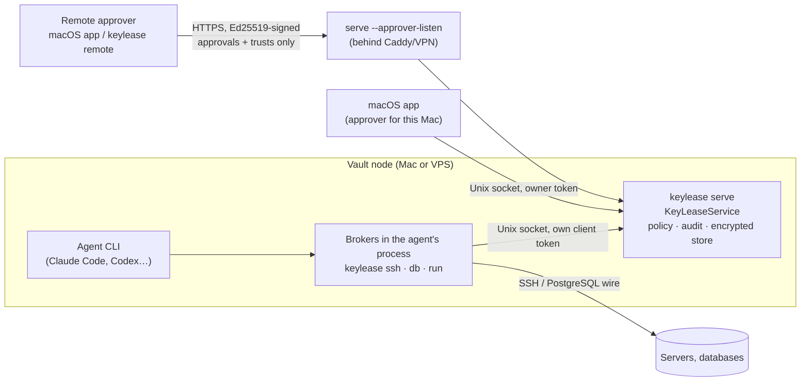
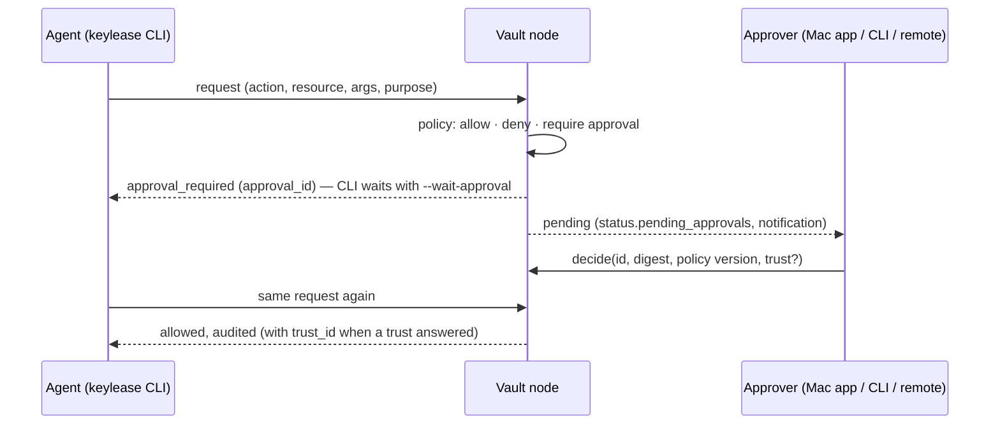

# Architecture overview

This page is the map. Decisions and their reasons are in [`docs/adr/`](adr/);
practical setups are in [use cases](use-cases.md); the security analysis is
in the [threat model](security/threat-model.md).

## Two products in one repository

| | KeyLease vault node | LeaseGate Cloud + Edge |
|---|---|---|
| What it is | An encrypted vault with a policy engine, served by `keylease serve` over a local Unix socket | A self-hosted control plane (Cloud API, worker, PostgreSQL) plus a gateway (Edge) that serves MCP and dynamic credentials |
| Who uses it | One person: agents on a Mac or a VPS | An operator running agents against SaaS connectors with signed policy bundles |
| Agent interface | `keylease` CLI (and the brokers below), MCP over stdio, the OAuth MCP gateway | MCP over Streamable HTTP, credential API |
| Approver | macOS app, `keylease approval …`, paired remote approver | `apps/approval-flutter` web/mobile app |
| Docs | this page, [ADR 0005](adr/0005-agent-trust-and-secret-use.md) | [Phase 3 architecture](phase-3/architecture-and-tech-stack.md), [single-VPS install](self-hosted-vps.md) |

Both share the same core: `KeyLeaseService` is the only layer that touches
storage, policy or connectors ([ADR 0003](adr/0003-command-policy-boundary.md)).
The CLI daemon, the MCP adapter, the mobile FFI and the desktop apps are
transport adapters around it.

The rest of this page is about the vault node, which is where agent secret use
lives.

## Roles

- **Vault node** — the process holding the unlocked vault: the macOS app's
  background daemon, or `keylease serve` under systemd on a VPS.
- **Agent** — any process with its own client identity
  (`keylease agent enroll`, or `client register` on a headless host).
  It can search and read metadata; using a secret or changing the vault queues
  an approval.
- **MCP surfaces** — `keylease mcp` (stdio, started by Claude Desktop, Cursor,
  Codex as an enrolled agent) and the gateway (`serve --gateway-url`: OAuth
  2.1 + Streamable HTTP for ChatGPT and claude.ai; each connection is a new
  agent). Both expose the same tools, none of which returns a secret
  ([MCP](mcp.md), [gateway](mcp-gateway.md)).
- **Approver** — a human surface that decides approvals: the macOS app on the
  same Mac, the admin CLI on the node, or a paired remote device. An approver
  is never the agent that asked.
- **Cloud member** — a vault linked to a KeyLease Cloud relay
  ([ADR 0006](adr/0006-node-identity-cloud-relay-and-sharing.md),
  [cloud sharing](cloud-sharing.md)): the **owner** (your device, holding the
  owner keys) or a **node** (a VPS). Identity has two levels: what data a
  member holds is decided by encryption to that member; what an agent on it
  may use is decided by policy and approvals. The relay stores public keys,
  sealed mailboxes and sealed backups only.

## How an agent uses a secret without seeing it

From most to least preferred (ADR 0005 section 3):

| Tier | Mechanism | Status | Agent receives |
|---|---|---|---|
| T0 Execute | Typed SaaS connectors (`leasegate.execute`); MCP `db_query` | **Yes** (PostgreSQL via `psql` through the proxy) | The result only |
| T1 Proxy | `keylease ssh` / `ssh-agent` (signing in the service); `keylease db` (SCRAM answered by the service) | **Yes** (SSH, PostgreSQL). HTTP header proxy: **no** | A socket, never the secret |
| T2 Ephemeral | AWS STS, SSH certificates, PostgreSQL roles (Edge credential API) | In the Edge only, not wired to the vault node | Short-lived material |
| T3 Inject | `keylease run --env NAME=ITEM/field -- cmd`, output scrubbed | **Yes** | Nothing directly; the child process gets the value |
| T4 Reveal | `entries reveal`, `entries totp` | **Yes** | Plaintext |

T3 is risk R3: approved per run or trusted for up to an hour, since the agent never reads the
value (within that hour it could run a program that prints the value encoded; see
[run with secrets](run-with-secrets.md)). T4 is risk R4: approved once per use, never trusted.

## Approval and trust

- An approval is bound to the request's canonical digest and policy version.
  It authorizes **one** use unless the approver turns it into a **trust**.
- A trust lets the same agent repeat the same action on the same resource (or
  any field of the same item) for a window: 30m, 1h, 6h, 1d, 3d or 7d, capped
  by risk tier — R0–R1 up to 7d, R2 up to 1d, R3 up to 1h, R4 once only.
- A **project** trust covers everyday work (the approved action and every
  action up to R2) on every item of the vault project the request touches, for
  at most 1d (1h when the approved action is R3). It is stored as a rule on
  `kl://VAULT/project/PROJECT`, which the daemon checks only when a request
  would otherwise ask.
- Trusts end at expiry, on revoke, when the client is revoked or when the kill
  switch is turned on. Every use is audited with its `trust_id`.

Details: [agent approvals and trust](agent-approvals.md).

## Deployment modes

| Mode | Vault node | Approver | Unlock |
|---|---|---|---|
| Personal Mac | macOS app daemon | macOS app (notification, Touch ID for trusts) | Master password in the app |
| VPS, self-trust (mode A) | `keylease serve` under systemd | Admin CLI on the VPS (`approval approve`), or pre-approved `grant`s | systemd credential, password file, or interactive |
| VPS + paired approver (mode B) | `keylease serve --approver-listen` behind TLS | macOS app **Remote Vaults**, or `keylease remote` on a laptop | Same as mode A (remote unlock not implemented) |
| VPS gateway for web assistants | `keylease serve --gateway-url` behind TLS | Same as mode A or B | Same as mode A |
| VPS as a cloud node | any of the above, linked with `keylease cloud join` | Share requests decided on the owner device | Same as mode A; data beyond its own arrives only as approved shares |
| LeaseGate Cloud + Edge | Edge's embedded `KeyLeaseService` | `approval-flutter` | Edge vault password file |

## Component map

| Path | Role |
|---|---|
| `crates/keylease-core` | Domain, request, identity, trust and audit contracts |
| `crates/keylease-crypto`, `keylease-store` | Envelope encryption, SQLite ciphertext store, journals |
| `crates/leasegate-policy` | Deny-by-default rules and approvals |
| `crates/keylease-service` | The only orchestration layer: vault, policy, trust, SSH signing, SCRAM, injection, remote approvers |
| `crates/keylease-rpc` | The local RPC contract (frozen by `test-vectors/rpc/commands.json`) |
| `crates/keylease-cli` | `keylease` CLI, daemon, brokers (`ssh`, `db`, `run`), MCP server (`mcp.rs`), gateway HTTP + OAuth (`gateway.rs`), approver HTTP API, cloud commands and sync loop (`cloud.rs`) |
| `crates/leasegate-mcp` | Streamable HTTP MCP adapter over the service (connector actions) |
| `crates/leasegate-edge`, `keylease-cloud`, `leasegate-credentials` | LeaseGate Edge gateway, Cloud control plane, dynamic credentials |
| `apps/desktop-macos`, `apps/desktop-macos-app` | Native Swift client core and SwiftUI app |
| `packages/leasegate_vault_ui` | Shared Flutter vault UI for the mobile app |
| `apps/mobile-flutter`, `crates/keylease-mobile` | Android vault client and its in-process FFI |
| `apps/approval-flutter` | LeaseGate Cloud approval and Edge health app |
